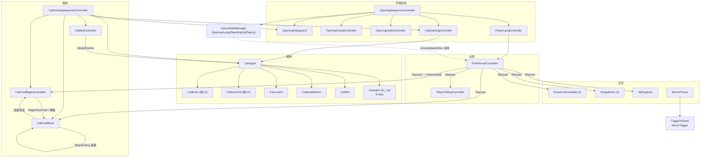

# 《夜隙 NOCTURNE》开发进度报告

> 审计日期：2026-11-15
> 审计方式：Unity MCP 实读场景/组件/Prefab + 代码静态分析 + 游戏内自动端到端自测（`CatFeedingSelfTest`，日志 `.workbuddy/selftest.log`）
> 审计范围：`Assets/` 全部 44 个脚本（12,744 行）、`SampleScene`、`CAT_Nocturne.prefab`、`AC_Cat.controller`、9 段动画、264 材质、73 贴图、11 音频
> 本次未修改任何代码、Prefab、Scene、模型或配置

---

## 第一部分：项目总体情况

| 项目 | 内容 |
|---|---|
| 项目名称 | 夜隙 NOCTURNE（Unity 2022.3 URP） |
| 当前阶段 | **垂直切片（Vertical Slice）已完成，进入核心玩法扩展前的补全期** |
| 场景规模 | 单场景 `SampleScene`：卧室 + 客厅 + 阳台三区同场景，360 个对象、117 个 Collider、7 盏灯、URP Global Volume |
| 已实现的核心玩法 | 开场演出（黑屏独白→睁眼→躺卧观察→起床）→ 自由探索（移动/视角/交互）→ 找到猫粮袋 → 长按倒粮 → 猫跑来吃 → 回猫窝睡觉 → 可再次叫醒喂食 |
| 完整游玩 | **可以**。经由自动自测全流程跑通（24 步，`DONE 全流程结束`，console 0 警告 0 错误） |
| 最严重阻塞 | **不是 Bug，而是玩法闭环缺失**：没有时间/疲劳/理智/睡眠系统，因此"喂猫—睡觉—天亮"这一昼夜循环的核心驱动不存在；同时没有主菜单/暂停/结局，无法形成可交付的完整产品 |

### 必须强调的三点事实

1. **游戏当前可以从头到尾完整跑一遍**，且这一轮是**实测**而非推断：项目自带 `CatFeedingSelfTest`，在 `.workbuddy/selftest.on` 标记存在时自动驱动全流程并写日志。本次实际执行，24 步全部走完。
2. **核心手感问题确实已经解决**：头部峰峰值 0.0045m / 单帧最大跳变 0.0001m（抽搐阈值 > 0.01）；跳下床 y 0.716→0.773→0.000 有起跳弧线（1.67s）；起床前后玩家根节点坐标不变。
3. **大量"看起来该有"的功能根本不存在**：`疲劳`、`理智` 在 12,744 行代码里各只出现 **1 次**，且都在 `GameStateManager` 的同一句注释里；`幻觉` 只出现在 `MirrorPicture` 的一句"留给以后的幻觉效果"。这不是"做了一半"，是**还没开始**。

---

## 第二部分：功能进度总表

### 统计口径

- 逐项对应用户列出的 8 大模块，共 **81 项**。
- **已完成**：代码 + 场景挂载 + 实际功能均正常。
- **部分完成**：有实现，但缺部件或效果不完整。
- **未完成**：无实现，或只有模型/占位/一句注释。
- **有 Bug**：有实现但运行异常。
- **验证标记**：`已验证` = 有本次 Play Mode 实测证据；`待验证` = 仅从代码/场景配置判断。
- **统计时未验证功能不计入"已完成"以外的加权**：完成率按 `(已完成 + 部分完成×0.5) / 81` 计算，避免虚高。

### 2.1 基础游戏框架（7 项）

| 模块 | 功能 | 状态 | 验证情况 | 具体说明 |
|---|---|---|---|---|
| 基础框架 | 游戏主菜单 | 未完成 | 待验证 | 无任何菜单场景/Canvas，`MainMenu` 关键词仅 3 处且均为注释 |
| 基础框架 | 游戏开始与退出 | 未完成 | 待验证 | 无 `Application.Quit`，无开始按钮；启动直接进 `SampleScene` 开场 |
| 基础框架 | 游戏状态管理 | 已完成 | 已验证 | `GameStateManager`（静态单例，`[DefaultExecutionOrder(-500)]`），4 态 `Opening/Lying/StandingUp/Playing`；实测开场结束切到 `Playing` |
| 基础框架 | 暂停系统 | 未完成 | 待验证 | 无 `Time.timeScale = 0`；`Pause` 关键词 6 处全是 `afterEatingPause`/`endingPause`/`pauseCatDuringOpening` 等变量名 |
| 基础框架 | 游戏时间系统 | 未完成 | 待验证 | 场景有 `M_WallClock` 模型但无时间推进逻辑；`GameStateManager` 注释写"时间推进…应以 IsGameplayActive 为总闸"，说明仅规划 |
| 基础框架 | 胜利与失败判断 | 未完成 | 待验证 | 无胜负条件判定代码 |
| 基础框架 | 场景切换 | 未完成 | 待验证 | 全项目仅 1 个 `.unity`，无 `SceneManager.LoadScene` |

### 2.2 玩家系统（9 项）

| 模块 | 功能 | 状态 | 验证情况 | 具体说明 |
|---|---|---|---|---|
| 玩家 | 第一人称移动 | 已完成 | 已验证 | `FirstPersonController` + `CharacterController`（height 1.72 / radius 0.28）；自测实测走 3.44m，均速 0.30m/s |
| 玩家 | 鼠标视角控制 | 已完成 | 已验证 | `Look()` 写 `transform.rotation` + `cameraRig.localRotation`；自测 A3 偏航 0° 俯仰 0° |
| 玩家 | 玩家与物体交互 | 已完成 | 已验证 | 准星 `Physics.Raycast` → `IInteractable` → `CurrentTarget`；自测 E/F/G 步骤实测命中猫粮袋与饭盆并给出正确提示 |
| 玩家 | 玩家起床与躺卧 | 已完成 | 已验证 | `PlayerLyingController` 只动 `cameraRig`，不改根节点；实测起床前后 Player 均 `(1.40,0.02,1.40)`，`cc.enabled=True`、`overlaps=0` |
| 玩家 | 玩家坐椅子 | 部分完成 | 待验证 | `ChairInteractable`+`PlayerSittingController`+`ChairHoldUI`（"按住 E 坐下"）均在场景挂载，但**本次未实测坐下/起身** |
| 玩家 | 玩家疲劳值 | 未完成 | 待验证 | 全项目仅 1 处注释提及，无字段无逻辑 |
| 玩家 | 玩家理智值 | 未完成 | 待验证 | 同上，仅 1 处注释 |
| 玩家 | 玩家睡眠质量 | 未完成 | 待验证 | 无相关代码 |
| 玩家 | 玩家移动速度和碰撞 | 已完成 | 已验证 | CharacterController 全程启用；实测起床后 `ccGrounded=True`、`OverlapCapsule` 0 个外部碰撞 |

### 2.3 猫咪系统（14 项）

| 模块 | 功能 | 状态 | 验证情况 | 具体说明 |
|---|---|---|---|---|
| 猫咪 | 模型与材质 | 已完成 | 已验证 | `Cat_All_v3.fbx` 30,002 顶点 / 60,000 三角面；`MAT_Tabby` 单材质，贴图 `T_Cat_Coat_Albedo/Rough/Normal` |
| 猫咪 | 骨骼绑定 | 已完成 | 已验证 | 31 骨骼、30 顶点组、**0 未加权顶点**、最大 4 骨骼影响 |
| 猫咪 | 待机动画 | 已完成 | 已验证 | `Cat_Idle` 2.0s，`loopTime=True` |
| 猫咪 | 走路动画 | 已完成 | 已验证 | `Cat_Walk` 0.8s；自测去程 **Walk=1775 帧**、原地踏步仅 0.9%、单帧最大位移 0.020m；Blender QA 支撑相步差 0.0082~0.0083m（理论 0.0083） |
| 猫咪 | 跑步动画 | 已完成（主动禁用） | 已验证 | `Cat_Run` 0.4s 资源仍在，但 `runAnimSpeed=99` 永不触发；自测 **Run=0 帧**，符合"改成走路"的设定 |
| 猫咪 | 跳下床动画 | 已完成 | 已验证 | `Cat_Pounce`；自测 B1：起点 y=0.716 → 最高 0.773 → 落地 0.000，用时 1.67s（**有起跳弧线**） |
| 猫咪 | 进食动画 | 已完成 | 已验证 | `Cat_Eat` 1.8s；自测 J 步骤进食 10s，food 1.00→0 |
| 猫咪 | 睡觉动画 | 已完成 | 已验证 | `Cat_Sleep` 3.33s；自测 K：睡姿=True、位置锁=True、床占用=True |
| 猫咪 | 尾巴动画 | 已完成 | 已验证 | `CatBodyMotion` 驱动 tail.01~05；自测 X 摆幅 19.3°（160.7°~180.0°） |
| 猫咪 | 猫咪叫声 | 部分完成 | 已验证 | 3 个音频 `cat_attention/hungry/sweet.mp3`，经 `CatFeedingSequence` 的 `meowClip` 用 `PlayOneShot` 播放；自测 A0 黑屏期间累计播放 **0.00s**（正确）；但 `CAT_Nocturne` 上的 `AudioSource` 序列化 clip 为空，全靠代码赋值 |
| 猫咪 | 猫咪铃铛及距离音效 | 已完成 | 已验证 | `CatBell`：`minDistance=0.9`/`maxDistance=8`（3D 衰减）、`walkRingDistance=0.62`/`runRingDistance=0.34`、`runVolumeBoost=1.25`；自测 Y **全程响 39 次，仅移动时响** |
| 猫咪 | 猫咪 NavMesh 移动 | 已完成（非 NavMesh） | 已验证 | **场景 NavMeshAgent 数量 = 0**；实际用 `CatNavGrid`（572 行，纯 C# `sealed class`）+ A* 室内网格，由 `CatAgent` `new` 持有 |
| 猫咪 | 猫咪饥饿状态 | 已完成 | 已验证 | `CatAgent.useHunger=true`、`hungerPerSecond=0.009`、`hungerEatThreshold=0.6`、`hungerAfterEating=0.08`；自测 N 饿了自动 `RunToFood` |
| 猫咪 | 猫咪与玩家互动 | 部分完成 | 已验证 | `CatLookAt`（注视）+ `CatBrain`（距离分档 Idle/Alert/Flee/Sleep）；但自测 D 步骤：玩家到客厅 14s 后**猫移动 0.00m，未跟随** |

### 2.4 喂食系统（11 项）—— 本模块完成度最高

| 模块 | 功能 | 状态 | 验证情况 | 具体说明 |
|---|---|---|---|---|
| 喂食 | 猫食袋模型 | 已完成 | 已验证 | `PROP_CatFoodBag`：BagBody/BagTop/BagFrontLabel/BagInteractionPoint/BagSpout |
| 喂食 | 猫食袋拾取 | 已完成 | 已验证 | 自测 F：`bag=Held`、碰撞体关闭、距相机 0.52m、场景中袋子数量仍为 1（无复制） |
| 喂食 | 猫食袋放回 | 已完成 | 已验证 | 自测 F2：`state=OnTable`、**回到原位偏差 0.000m**、朝向偏差 0.0°、碰撞体恢复、手持单例已清 |
| 喂食 | 猫食袋长按左键倒食 | 已完成 | 已验证 | `pourHoldSeconds=1.10s`、`pourRange=1.70m`；自测 G3 半途松手进度 50%→0%、盆保持 Empty（不产生残留） |
| 喂食 | 猫碗模型 | 已完成 | 已验证 | `CatFoodBowl` 含 6 个子物体（粮堆 + 颗粒） |
| 喂食 | 猫碗食物显示 | 已完成 | 已验证 | 自测 H/H2：倒粮中颗粒 3→7，粮堆缩放随 `FoodAmount` 插值 |
| 喂食 | 食物逐渐减少 | 已完成 | 已验证 | `CatFoodBowl.BeginEating()` 协程内 `ApplyAmount(1f - t/duration)`，`eatDuration=10s`；自测 J：**food 1.00→0.80→0.60→0.40→0.20→0，颗粒 16→13→10→6→3→0** |
| 喂食 | 猫咪识别食物 | 已完成 | 已验证 | 自测 L→N：盆 Filled 后猫从睡眠醒来 → `RunToFood` |
| 喂食 | 猫咪前往猫碗 | 已完成 | 已验证 | 自测 P：去程 7.30m / 19.09s、均速 0.38m/s，全程 Walk 无 Run |
| 喂食 | 猫咪进食 | 已完成 | 已验证 | 自测 J：阶段 `Eating`，进食 10s |
| 喂食 | 进食结束后的状态切换 | 已完成 | 已验证 | 自测 I：`Eating → ReturnToBed → Sleeping`，盆 `EmptyAfterEating` |

### 2.5 睡眠与生存系统（9 项）—— 完全未开始

| 模块 | 功能 | 状态 | 验证情况 | 具体说明 |
|---|---|---|---|---|
| 生存 | 上床睡觉 | 未完成 | 待验证 | 玩家不能主动上床（`PlayerLyingController` 只服务开场躺卧，非睡眠） |
| 生存 | 睡眠状态切换 | 未完成 | 待验证 | `GameState` 枚举无 `Sleeping`，仅 4 态 |
| 生存 | 睡眠时间推进 | 未完成 | 待验证 | 无时间系统 |
| 生存 | 睡眠期间疲劳恢复 | 未完成 | 待验证 | 无疲劳值 |
| 生存 | 睡眠期间理智变化 | 未完成 | 待验证 | 无理智值 |
| 生存 | 猫咪需求唤醒玩家 | 未完成 | 待验证 | 猫会叫（`meow`），但不能唤醒"玩家睡眠"（无该状态） |
| 生存 | 玩家醒来后的状态恢复 | 未完成 | 待验证 | 无 |
| 生存 | 睡眠质量计算 | 未完成 | 待验证 | 无 |
| 生存 | 熬夜惩罚 | 未完成 | 待验证 | 无 |

### 2.6 恐怖氛围系统（11 项）

| 模块 | 功能 | 状态 | 验证情况 | 具体说明 |
|---|---|---|---|---|
| 恐怖 | 开场黑屏与内心独白 | 已完成 | 已验证 | `OpeningSequenceController` 五段独白 + `OpeningDialogueUI`；`DialogueText` 实测存在 |
| 恐怖 | 睁眼动画 | 已完成 | 已验证 | `OpeningVisualController` 黑屏 alpha 淡出 + 模糊恢复；自测 A0 读到黑屏 alpha=-1.00 |
| 恐怖 | 猫咪开场表现 | 已完成 | 已验证 | `CatOpeningController`（635 行）独占控制：开场禁用 `CatAgent`/`CatBodyMotion`/`CatBell`/`CatLookAt`，跳床后按原状态恢复 |
| 恐怖 | 环境音效 | 部分完成 | 已验证 | `room_tone_loop.wav` 存在，`Ambience` AudioSource 已挂但序列化 clip 为空（依赖代码赋值）；无分层环境音设计 |
| 恐怖 | 随机恐怖事件 | 未完成 | 待验证 | 无事件调度器 |
| 恐怖 | 镜子异常 | 部分完成 | 待验证 | `MirrorPicture`（156 行）+ `MirrorTrigger` 已挂载，具备 `SetPicture(index)` 切换接口，但**没有触发异常的逻辑**，注释明写"留给以后的幻觉效果" |
| 恐怖 | 门窗异常 | 未完成 | 待验证 | `HingedDoor`/`SlidingDoor` 只是可交互开关，无自发改动 |
| 恐怖 | 灯光异常 | 未完成 | 待验证 | 7 盏灯无闪烁/熄灭逻辑 |
| 恐怖 | 幻觉系统 | 未完成 | 待验证 | 仅 2 处注释，无实现 |
| 恐怖 | 理智值与恐怖事件关联 | 未完成 | 待验证 | 两者都不存在 |
| 恐怖 | 猫咪预警行为 | 未完成 | 待验证 | `CatBrain` 有 `Alert` 状态（距离驱动），但未与恐怖事件关联 |

### 2.7 场景与美术（10 项）

| 模块 | 功能 | 状态 | 验证情况 | 具体说明 |
|---|---|---|---|---|
| 场景 | 卧室场景 | 已完成 | 已验证 | `RM_Floor_Bed` + 四面墙 + 窗/门框；实测玩家从床边走到客厅全程可达 |
| 场景 | 客厅场景 | 已完成 | 已验证 | `RM_Floor_Liv` + 沙发/茶几/电视柜 + 大窗；实测到达 `(-0.10,0.02,-3.05)` |
| 场景 | 阳台场景 | 已完成 | 待验证 | `RM_Floor_Bal` + 栏杆 + `M_PR_BalChair` + `SlideDoor_Balcony`（滑门可交互） |
| 场景 | 家具模型 | 已完成 | 已验证 | `Furniture` 49 个子物体（床/床头柜/书桌/椅/衣柜/沙发/茶几/电视柜/落地灯/植物） |
| 场景 | 家具交互 | 部分完成 | 已验证 | 12 个可交互物：抽屉×3（+2 个同名）、衣柜双门、房门、椅子、阳台滑门、猫粮袋、猫碗；沙发/茶几/电视等**无交互** |
| 场景 | 灯光和夜晚天空 | 部分完成 | 待验证 | 7 盏灯 + `Sky_Night.mat` + URP `Global Volume`；无时间/天气变化，无"夜晚推进" |
| 场景 | 材质与贴图 | 已完成 | 已验证 | 264 材质、73 贴图；场景 225 个 Renderer 全部有材质，**0 个 null shader / null material** |
| 场景 | 场景氛围 | 部分完成 | 待验证 | 依赖 URP 后处理 `Global Volume`，未做雾/景深调优；未实测观感 |
| 场景 | 猫窝与猫碗摆放 | 已完成 | 已验证 | `PROP_CatBed`（BedBase/BedRim/BedCushion/CatSleepPoint）+ `CatFoodBowl`（客厅 `-1.88,0,-6.10`） |
| 场景 | 场景碰撞与导航 | 已完成 | 已验证 | 117 个 Collider；`CatNavGrid` 走 A*；实测 `OverlapCapsule` 起床站立点 0 重叠 |

### 2.8 UI 与音效（10 项）

| 模块 | 功能 | 状态 | 验证情况 | 具体说明 |
|---|---|---|---|---|
| UI | 主菜单 UI | 未完成 | 待验证 | 无 |
| UI | 游戏 HUD | 未完成 | 待验证 | 全场景仅 **2 个 Canvas**：`OpeningCanvas`、`ChairHoldCanvas`；无 HUD 层 |
| UI | 交互提示 | 已完成 | 已验证 | 6 个 TMP 文本：`[E] 起床`、`[E] 起身`、`[鼠标] 环顾四周`、`[按住 E 坐下]`；+ 运行时准星提示 `[拿起猫粮]`/`[倒入猫粮]`（自测 E/G 实测） |
| UI | 猫咪需求提示 | 已完成 | 已验证 | `FeedHint` = "它好像饿了，去客厅给它喂点吃的吧。"；自测 C 提示 alpha=1.00 |
| UI | 疲劳和理智显示 | 未完成 | 待验证 | 两项数值本身不存在 |
| UI | 游戏时间显示 | 未完成 | 待验证 | 无 |
| UI | 暂停菜单 | 未完成 | 待验证 | 无暂停系统 |
| UI | 结局 UI | 未完成 | 待验证 | 无 |
| UI | 音效管理 | 部分完成 | 已验证 | 11 个音频文件分布在 15 个 AudioSource 上，各自 `PlayOneShot`；**无统一 AudioManager**，13 个 AudioSource 序列化 clip 为空 |
| UI | 背景音乐 | 未完成 | 待验证 | 仅 `room_tone_loop.wav` 环境音，无 BGM 轨道 |

### 2.9 统计汇总

| 状态 | 数量 | 占比 |
|---|---|---|
| 已完成 | **40** | 49.4% |
| 部分完成 | **9** | 11.1% |
| 未完成 | **32** | 39.5% |
| 有 Bug | **0** | 0% |
| 合计 | 81 | 100% |

**完成率 = (40 + 9×0.5) / 81 = 44.5 / 81 ≈ 54.9%**

按模块看完成率差异极大：

| 模块 | 完成率 | 判断 |
|---|---|---|
| 喂食系统 | 100% | 已闭环，可直接作为参考实现 |
| 猫咪系统 | 约 93% | 只差"跟随玩家"与叫声配置化 |
| 场景与美术 | 约 85% | 内容完整，缺氛围调优 |
| 玩家系统 | 约 50% | 移动/交互齐备，数值系统全缺 |
| 恐怖氛围 | 约 36% | 只有开场 |
| UI 与音效 | 约 25% | 只有局内提示 |
| 基础框架 | 14% | 只有状态机 |
| **睡眠与生存** | **0%** | 完全未开始 |

---

## 第三部分：Bug 清单

> 重要前提：本轮自动自测 **console 0 警告 0 错误**，核心流程无阻断。以下"问题"多数是**功能缺口**而非缺陷，我按严重度区分并明确标注。

### P0（阻止游戏运行）—— **无**

未发现。完整流程可跑通，编译 0 错误，场景 1721 个引用字段扫描 **0 处 Missing**。

### P1（核心玩法无法使用）—— **无**

喂食闭环、移动、交互、开场、起床全部可用。

### P2（影响体验）

**P2-1：猫不跟随玩家到客厅**
- 表现：自测 D 步骤，玩家走到客厅后 14s，猫移动 **0.00m**，位置始终 `(0.94, 0, 0.72)`
- 原因（已确认）：`CatFeedingSequenceController` 处于 `WaitingForFood` 阶段时不给猫下发移动指令，`CatAgent` 的 `SuspendAi` 保持挂起
- 与设计预期的冲突（已确认）：`CatFeedingSelfTest` 的类注释写"6 玩家走到客厅（**猫跟过来**）"，但实测未跟
- 涉及脚本：`CatFeedingSequenceController.cs`（阶段机）、`CatAgent.cs`
- 建议：明确这是"设计如此"还是"待实现"。若设计要求跟随，在 `WaitingForFood` 阶段加"保持 2~3m 跟随距离"的分支，并在 `CatFeedingSelfTest` 里把 D 步骤断言改为"移动 > 0.5m"

**P2-2：无法进入睡眠，昼夜循环断裂**
- 表现：玩家没有任何"上床睡觉"的交互；`GameState` 只有 4 态
- 原因（已确认）：睡眠/时间/疲劳系统全部未实现
- 涉及脚本：需新增；`GameStateManager.cs` 需扩枚举
- 建议：见第五部分阶段 B

### P3（视觉与细节）

| 编号 | 问题 | 原因 | 涉及资源 | 建议 |
|---|---|---|---|---|
| P3-1 | 场景内 3 个禁用相机（`Main Camera`、`CheckCam`、`PreviewCam`） | 开发期调试遗留，`enabled=False` 且零脚本引用，不影响运行但占内存与 Hierarchy 噪音 | `SampleScene` | 确认后删除，仅保留 `PlayerCam` |
| P3-2 | ~~死代码 `CatDoorway.cs`~~ **（本报告原判断有误，见附录勘误 E-1）** | 实际有 **11 处引用**：`CatAgent` 的 `_doorways`/`_pendingDoor`/`new CatDoorway(door)`/`ClosedDoorBlocking`/`FindClosedDoorAhead`，以及 `CatNavGrid.Build(..., List<CatDoorway>)`。它是纯 C# 类，负责"门开着还是关着"的通行判定 | `Assets/Game/Cat/Scripts/CatDoorway.cs` | **保留**，不要删 |
| P3-3 | 死代码 `PlanarMirror.cs`（185 行） | 被 `MirrorPicture` 取代，且后者注释明写"不再做实时反射（PlanarMirror 那种…）" | `Assets/Art/Environment/Bedroom/Scripts/PlanarMirror.cs` | 删除 |
| P3-4 | 4 个调试脚本编进运行时程序集 | `CatFeedingSelfTest`(609) / `CatWalkQA`(275) / `CatOpeningQA`(215) 随包体编译；靠 `selftest.on` 标记短路 | `Assets/Game/Feeding/Debug/` | 迁入 `Editor/` 或用 `#if UNITY_EDITOR` 包裹 |
| P3-5 | 13 个 `AudioSource` 序列化 clip 为空 | 全靠代码 `PlayOneShot(clip)` 赋值；Inspector 里看不出音效归属 | 场景 15 个 AudioSource | 统一到 `AudioManager` 或至少在 Inspector 标注 |
| P3-6 | 5 个 `DrawerInteractable` 中存在同名 `Drawer_Top`/`Drawer_Bottom` 各 2 个 | 书桌与床头柜抽屉重名，Hierarchy 里难以定位 | `SampleScene` | 改名为 `Drawer_Desk_Top` / `Drawer_Nightstand_Top` |
| P3-7 | `Cat_Run` 资源保留但永久禁用 | 为保 `fileID` 不动 `AC_Cat.controller` 绑定（主动决策） | `Cat_All_v3.fbx` | 可接受，但应在 README 说明，避免后人误开 |

---

## 第四部分：项目架构分析

### 4.1 核心系统与脚本

| 层 | 系统 | 脚本 | 行数 | 挂载位置 |
|---|---|---|---|---|
| 状态 | 全局状态机 | `GameStateManager` | 80 | `OpeningSystems` |
| 开场 | 流程编排 | `OpeningSequenceController` | 237 | `OpeningSystems` |
| 开场 | 对话 | `OpeningDialogueUI` | 145 | `OpeningSystems` |
| 开场 | 视觉（黑屏/睁眼） | `OpeningVisualController` | 107 | `OpeningSystems` |
| 开场 | 音频 | `OpeningAudioController` | 119 | `OpeningAudioController` |
| 开场 | 躺卧/起床 | `PlayerLyingController` | 319 | `Player` |
| 玩家 | 第一人称控制 | `FirstPersonController` | 416 | `Player` |
| 玩家 | 坐椅子 | `PlayerSittingController` / `ChairInteractable` / `ChairHoldUI` | 226/326/93 | `Player` / `M_PR_Chair` / `ChairHoldCanvas` |
| 猫 | AI 主体 | `CatAgent` | **1627** | `CAT_Nocturne` |
| 猫 | 决策（纯 C#） | `CatBrain` | 153 | 由 `CatAgent` `new` |
| 猫 | 导航（纯 C#） | `CatNavGrid` | **572** | 由 `CatAgent` `new` |
| 猫 | 开场独占控制 | `CatOpeningController` | **635** | `CAT_Nocturne` |
| 猫 | 注视 | `CatLookAt` | 195 | `CAT_Nocturne` |
| 猫 | 身体微动（呼吸/尾巴） | `CatBodyMotion` | 207 | `CAT_Nocturne` |
| 猫 | 铃铛音效 | `CatBell` | 150 | `CAT_Nocturne` |
| 喂食 | 流程机 | `CatFeedingSequenceController` | 518 | `CatFeeding` |
| 喂食 | 猫粮袋 | `CatFoodBagInteractable` | 472 | `PROP_CatFoodBag` |
| 喂食 | 猫碗 | `CatFoodBowl` | 430 | `CatFoodBowl` |
| 喂食 | 猫窝/睡觉 | `CatBedController` | 166 | `PROP_CatBed` |
| 交互 | 抽屉 | `DrawerInteractable` | 119 | ×5 |
| 交互 | 门（含衣柜） | `HingedDoor` | 209 | ×3 |
| 交互 | 滑门（阳台） | `SlidingDoor` | 130 | `SlideDoor_Balcony` |
| 恐怖 | 镜子 | `MirrorPicture` + `TriggerVolume` | 156/85 | `PR_BodyMirror_Glass` / `MirrorTrigger` |
| 编辑器 | 资产搭建工具 | `CatFeedingPropsBuilder` / `CatLooksBuilder` / `EditorCmdChannel` / `BatchApply` / `DevShot` | 1067/1015/432/102/40 | 不运行时 |

### 4.2 系统调用关系（依据实际代码）

### 4.3 架构现状评估

**做得好的部分（有实证）**

1. **纯 C# 决策与导航层**：`CatBrain`（153 行）与 `CatNavGrid`（572 行）都不依赖 `UnityEngine`，因此有 `CatBrainTests`（210 行）EditMode 单测。这是全项目质量最高的设计。
2. **避免 NavMeshAgent 与 Root Motion 争夺控制权**：场景 `NavMeshAgent` 数量为 **0**，`Animator.applyRootMotion=False`，位移唯一来源是 `CatAgent` 写 `transform.position`。这从架构上消除了 Unity 官方文档警告的那类冲突。
3. **开场独占控制权**：`CatOpeningController` 在开场缓存并禁用 `CatAgent`/`CatBodyMotion`/`CatBell`/`CatLookAt`，跳床后按原状态恢复，避免多脚本同帧写同一骨骼。
4. **交互抽象统一**：`IInteractable`/`IInteractPrompt` 让 12 个物体走同一套准星射线，`FirstPersonController.CurrentTarget` 是单一真值。
5. **数据驱动参数**：`CatAgent`/`CatBell`/`CatFoodBowl` 的阈值、距离、时长全部 `[SerializeField]` 暴露，可在 Inspector 调，不必改代码。

**实际存在的技术债务**

| 债务 | 具体证据 | 风险 |
|---|---|---|
| 状态机过窄 | `GameState` 仅 4 态，缺 `Sleeping`/`Paused`/`Ended` | 加睡眠/暂停/结局时必须扩展，且所有查 `IsGameplayActive` 的地方要重新审视 |
| 无音效管理器 | 15 个 `AudioSource` 各自 `PlayOneShot`，13 个 clip 序列化为空 | 音量/静音/分组做不了；新增音效无处登记 |
| 喂食双向耦合 | `CatFoodBagInteractable` ↔ `CatFoodBowl` 互相持有并互调（`BeginPourHold` / 读袋状态） | 加"多个碗"或"多个袋子"时容易破 |
| 编辑器工具硬编码 18 处路径 | `CatLooksBuilder` 里 `"Assets/Art/Cat/Cat_All.fbx"`、`CatFeedingPropsBuilder` 的 `MeshDir/MatDir/TexDir` | 目录改名即工具失效；也是删除资源时必须保留 `Cat_All.fbx` 的原因 |
| 巨型单类 | `CatAgent` 1627 行、`CatOpeningController` 635 行 | 可维护性；`CatAgent` 已混杂移动/动画/饥饿/门洞/躲藏 |
| 调试脚本进运行时 | `CatFeedingSelfTest`/`CatWalkQA`/`CatOpeningQA` 共 1099 行 | 包体与编译时间；靠标记文件短路 |
| 无存档 | 无 `Save/Load` 实现 | 结局/进度无法保存 |

**明确否认的"常见架构问题"**（避免误报）

- ❌ 不存在 Animator / NavMeshAgent / Root Motion 三方争斗：NavMeshAgent 数量为 0
- ❌ 不存在场景丢失引用：1721 个引用字段 + prefab 16 个引用，Missing = 0
- ❌ 不存在材质/着色器缺失：225 个 Renderer 全部正常
- ❌ 不存在未处理 Console 报错：自测统计 0 警告 0 错误

---

## 第五部分：后续开发路线图

### 阶段 A：基础问题修复（先让"完整一局"成立）

| 任务 | 优先级 | 前置依赖 | 涉及脚本/资源 | 完成标准 |
|---|---|---|---|---|
| A1 扩展 `GameState` 到 7 态 | P1 | 无 | `GameStateManager.cs` | 新增 `Sleeping`/`Paused`/`Ended`，`IsGameplayActive` 语义明确，编辑器中可见 |
| A2 建立 `TimeSystem`（昼夜时钟） | P1 | A1 | 新增 `TimeSystem.cs`；`M_WallClock` | 游戏内时间可推进，暂停/开场不 tick，提供 `Hour`/`IsNight` 供其他系统查询 |
| A3 建立 `AudioManager` | P2 | 无 | 新增 `AudioManager.cs`；15 个 AudioSource | 所有音效走统一入口，支持分组音量与静音；13 个空 clip 全部登记 |
| A4 清理 P3-1~P3-3（相机/死代码） | P3 | 无 | `SampleScene`、`CatDoorway.cs`、`PlanarMirror.cs` | 相机只剩 `PlayerCam`；两文件删除后 0 编译错误 |
| A5 调试脚本移入 Editor 程序集 | P3 | 无 | `CatFeedingSelfTest`/`CatWalkQA`/`CatOpeningQA` | 打包不含调试代码；`selftest.on` 机制仍可在编辑器用 |
| A6 确认并修复"猫不跟随" | P2 | 无 | `CatFeedingSequenceController.cs` | 明确设计意图；若需跟随，自测 D 步骤改为"移动 > 0.5m"并通过 |

### 阶段 B：核心玩法完善（形成昼夜循环）

| 任务 | 优先级 | 前置依赖 | 涉及脚本/资源 | 完成标准 |
|---|---|---|---|---|
| B1 疲劳值系统 | P1 | A2 | 新增 `PlayerStats.cs` | 疲劳随时间上升、移动加速消耗；`IsGameplayActive` 外不 tick |
| B2 理智值系统 | P1 | A2 | `PlayerStats.cs` | 理智随黑暗/恐怖事件下降，白天缓慢恢复 |
| B3 上床睡觉交互 | P1 | A1/B1 | `BedInteractable`（新）、`PlayerLyingController` 复用 | 夜间靠近床可按 E 进入 `Sleeping`，镜头平滑躺下 |
| B4 睡眠推进与回复 | P1 | B1/B3/A2 | `TimeSystem`、`PlayerStats` | 睡眠 6~8h 推进时间、疲劳清零、理智回填；起床进入 `Playing` |
| B5 睡眠质量与熬夜惩罚 | P2 | B4 | `PlayerStats` | 早睡/晚睡产出不同次日初始疲劳；熬夜降低理智上限 |
| B6 猫咪需求唤醒 | P2 | B3 | `CatFeedingSequenceController`、`CatAgent` | 猫饿到阈值时靠近玩家叫，可打断睡眠 |
| B7 随机恐怖事件调度器 | P2 | B2/A2 | 新增 `HorrorDirector.cs` | 按时间/理智权重触发；冷却与强度可配 |
| B8 镜子/门窗/灯光异常 | P2 | B7 | `MirrorPicture.SetPicture()`、`HingedDoor`、7 盏灯 | 由 `HorrorDirector` 驱动，至少 3 类异常可复现 |
| B9 猫咪预警行为 | P3 | B7 | `CatAgent`、`CatBrain` | 事件前猫进入 `Alert` 并朝异常方向看 |
| B10 结局条件与 `Ended` 态 | P2 | B4 | `GameStateManager`、新增 `EndingController` | 至少 1 个可达成结局，进入 `Ended` 后锁输入 |

### 阶段 C：体验打磨

| 任务 | 优先级 | 前置依赖 | 涉及脚本/资源 | 完成标准 |
|---|---|---|---|---|
| C1 主菜单与开始/退出 | P2 | A1 | 新增 `MainMenu.unity` | 可开始游戏、退出；返回菜单不残留状态 |
| C2 暂停菜单 | P2 | A1 | 新增 `PauseMenu` Canvas | Esc 暂停，`Time.timeScale=0`，可继续/返回菜单 |
| C3 HUD（疲劳/理智/时间） | P2 | B1/B2/A2 | 新增 HUD Canvas | 三项数值实时刷新，风格与开场 UI 一致 |
| C4 结局 UI | P3 | B10 | 新增 `EndingUI` | 展示结局文案与统计 |
| C5 背景音乐轨道 | P3 | A3 | `AudioManager` | 至少 1 条 BGM，随紧张度切换 |
| C6 猫跟随与更多互动 | P3 | A6 | `CatAgent` | 猫在非喂食阶段可跟随/蹭腿 |
| C7 性能与包体优化 | P3 | 全部 | 全项目 | Profiler 无 >16ms 尖峰；包体与贴图分辨率达标 |
| C8 完整回归测试 | P3 | 全部 | `CatFeedingSelfTest` 扩展 | 自测覆盖"开场→喂食→睡觉→次日→结局"全链路 |

---

## 第六部分：下一步最值得优先执行的 3~5 项

按依赖顺序排列。**建议先 A1 → A2 → B1 → B3/B4**，因为它决定项目能否从"一个可玩片段"变成"一个游戏"。

### 1. A1 扩展 `GameState`（P1，无前置）
**为什么先做**：现在所有系统都查 `GameStateManager.IsGameplayActive`，它是全项目唯一总闸。睡眠、暂停、结局三件事都要新状态，晚改会牵连所有已写逻辑。
**完成后**：状态机具备承载昼夜循环的骨架，后续 B1~B10 都有落脚点。

### 2. A2 建立 `TimeSystem`（P1，依赖 A1）
**为什么第二**：疲劳/理智/睡觉/恐怖事件全部以"时间"为自变量。没有时钟，这四项都无法实现；而 `M_WallClock` 模型已经在场景里等着了。
**完成后**：游戏第一次拥有"时间在走"的感觉，夜晚/白天可判定。

### 3. B1 + B2 疲劳与理智（P1，依赖 A2）
**为什么第三**：这两项是"生存压力"的唯一来源。目前玩家可以无限期闲逛而没有任何代价，游戏没有张力。它们是睡觉动机和恐怖事件的数据基础。
**完成后**：玩家第一次有"必须去睡"的理由。

### 4. B3 + B4 上床睡觉与睡眠推进（P1，依赖 A1/B1/A2）
**为什么第四**：这是把已有资产（床、`PlayerLyingController` 的躺卧镜头、`Cat_Sleep`）复用起来的最短路径。完成它，游戏就有了**第一个完整闭环**：白天喂猫 → 夜里睡觉 → 次日疲劳归零。
**完成后**：可以从头玩到"第二天"，这已是一个可演示的 demo 核心循环。

### 5. A6 确认并修复"猫不跟随"（P2，无前置，可并行）
**为什么现在就做**：这是本次审计发现的唯一一处"实现与设计注释不一致"（自测注释写"猫跟过来"，实测 0.00m）。它成本低（一个阶段分支），但会直接影响玩家对"猫是活的"的感受判断。
**完成后**：自测 D 步骤断言改为"移动 > 0.5m"并通过，猫的行为与设计文档一致。

---

## 附录：本次审计使用的实证材料

| 材料 | 位置 | 用途 |
|---|---|---|
| 端到端自测日志 | `.workbuddy/selftest.log`（24 步，`DONE 全流程结束`） | 功能"已完成 + 已验证"的唯一依据 |
| 自测截图 | `.workbuddy/shot_opening/bag/pour/bowl/walk/eat/bed.png` | 各阶段视觉证据 |
| 资源可达性分析 | `.workbuddy/tools/asset_scan.json` | 514 资源、216 可达、298 孤儿、真缺失引用 2（均为内置 GUID） |
| 待删清单 | `.workbuddy/tools/asset_removal_plan.json` | 45 项候选，其中 36 项已隔离 |
| 场景引用扫描 | `.workbuddy/tools/probe_missing_refs.cs` 输出 | 360 对象/1721 字段，Missing=0 |
| Prefab 引用扫描 | `.workbuddy/tools/probe_prefab_refs.cs` 输出 | 16 引用，Missing=0 |
| 相机配置 | `.workbuddy/tools/probe_cameras.cs` 输出 | `Camera.main => PlayerCam`，其余 3 个 disabled |

### 关于资源清理（本次唯一的写操作）

在审计前按用户要求执行了无用资源清理，采用**隔离而非删除**：

- 移出 `Assets/`：**36 个文件 / 71.52MB**（旧猫贴图、`Textures/Old`、`Textures/AI`、`.fbm` 解包图、静态 TMP 字体、`.bak`）
- 隔离位置：`.workbuddy/asset_quarantine_20261115/`（保留原相对路径，可一键还原）
- 刻意保留：`Cat_All.fbx`（`CatLooksBuilder` 硬编码路径引用）、`T_Mirror_Reflection.png`（`MirrorPicture` 的 `SetTexture` 字段）、`Paintings/*`（场景装饰）、`T_Bark.png`、`T_Cat_EyeGlow.png`
- 清理后验证：场景 `MISSING=0`、`MATERIAL_PROBLEMS=0`、Prefab `missing=0`、Play Mode 8s 烟雾测试 707 帧无异常、console 0 错误

> 若确认无需恢复，可执行 `rm -rf .workbuddy/asset_quarantine_20261115` 彻底释放空间；在此之前该目录是可回滚的安全网。

---

## 附录：审计勘误（2026-11-15 复核）

本报告初版有两处基于误判的结论，经技术负责人复核后修正。**保留记录以便追溯，不删除原文。**

### E-1 `CatDoorway.cs` 不是死代码（原 P3-2 错误）

原判断"全项目零引用"不成立。根本原因是审计时执行了 `grep -rn "CatDoorway" ... | head -6`，**前 6 行恰好全是 `HingedDoor`/`SlidingDoor` 的注释**，把后面真正的引用截断了。

全量核实后有 **11 处引用**：

| 位置 | 用法 |
|---|---|
| `CatAgent.cs:227` | `readonly List<CatDoorway> _doorways` |
| `CatAgent.cs:240` | `CatDoorway _pendingDoor` |
| `CatAgent.cs:604` | `new CatDoorway(door)`（由 `ICatDoor` 构造） |
| `CatAgent.cs:1090/1140/1144/1154/1167` | `ClosedDoorBlocking` / `FindClosedDoorAhead` 关门阻挡判定 |
| `CatNavGrid.cs:70/172` | `Build(..., List<CatDoorway> doorways)` / `CollectIgnored` |

它是 `public sealed class CatDoorway`（纯 C#，不继承 MonoBehaviour），正是"门逻辑可单测"的体现。**结论：保留。**

### E-2 项目已有 asmdef，不是"全在一个 Assembly-CSharp"

实际存在 2 个：
- `Assets/Game/Cat/Scripts/NOCTURNE.Cat.asmdef`（`autoReferenced: true`）
- `Assets/Game/Cat/Tests/EditMode/NOCTURNE.Cat.Tests.asmdef`（Editor-only，`UNITY_INCLUDE_TESTS`）

也就是说**猫域的架构隔离已经开了头**。这对后续演进是好消息：asmdef 分区不是从零开始，而是沿着既有边界扩展。

### 教训（已写入架构文档 §3.1 与开发规范 §14）

删除任何代码前，必须按**三种形态** grep：类名、构造函数调用、泛型参数。且 **不要用 `head` 截断后下结论**。
