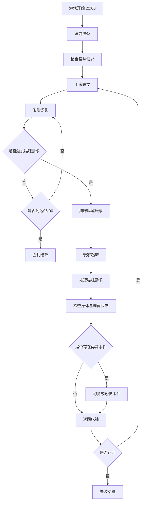

# 夜隙 NOCTURNE

> 在漫长的夜晚里，你唯一想做的事情就是睡个好觉。
>
> 可你的猫，似乎并不打算让你如愿。

**游戏策划案 / Game Design Document**

| 项目 | 内容 |
|---|---|
| 游戏名称 | 夜隙 NOCTURNE |
| 游戏类型 | 第一人称 3D 心理恐怖 / 生存模拟 |
| 开发引擎 | Unity |
| 开发语言 | C# |
| 目标平台 | PC / Windows |
| 游戏模式 | 单人 |
| 核心场景 | 一间卧室及相连的生活区域 |
| 单局时长 | 约 15～25 分钟 |
| 游戏时间 | 22:00～06:00 |
| 核心玩法 | 睡眠管理、猫咪照料、异常调查、理智管理 |
| 核心主题 | 现实与幻觉、孤独、睡眠剥夺、陪伴与保护 |
| 开发规模 | 独立单人开发 |

---

# 第一章：游戏概述

## 1.1 游戏背景

玩家是一名独居者，平时生活规律，晚上通常会在卧室休息。

家里养着一只猫。

它是一只普通的小猫，有自己的生活习惯和需求。它会饿，会渴，会想玩耍，也会在半夜因为无聊而跳上床，甚至抓挠家具。

玩家原本以为，这只是一个普通的夜晚。

然而，猫咪频繁的夜间活动让玩家不断从睡梦中醒来。

每一次醒来，都意味着睡眠被打断。

随着夜晚不断深入，玩家开始出现严重的疲劳和精神问题。

房间里的声音变得奇怪，家具似乎发生了变化，镜子中偶尔出现不属于自己的影子。

最奇怪的是，猫咪似乎总能提前察觉这些异常。

它会盯着空无一人的角落，会对着关闭的房门发出警告，甚至会在玩家准备睡觉时阻止玩家靠近床铺。

玩家逐渐产生一个疑问：

**究竟是自己因为睡眠不足而产生了幻觉，还是房间里真的存在某种东西？**

而那只一直在半夜吵醒自己的猫，似乎知道些什么。

## 1.2 核心玩法定位

《夜隙 NOCTURNE》不是传统意义上的追逐型恐怖游戏。

玩家不需要战斗，也不需要不断躲避怪物。

游戏的核心矛盾是：

- 玩家需要睡觉，但猫咪会不断打断睡眠。
- 玩家需要照顾猫咪，但每次起床都会消耗精力。
- 玩家需要保持理智，但房间中的异常会持续干扰精神状态。
- 玩家想要调查真相，却又必须抓紧时间恢复睡眠。
- 玩家越来越害怕房间，但猫咪似乎一直在试图保护自己。

**游戏真正的敌人不是猫咪，而是逐渐失控的夜晚。**

## 1.3 核心设计支柱

### 支柱一：睡眠即生存

睡觉是玩家恢复身体状态和精神状态的主要方式。

玩家需要合理安排睡眠，不能无限起床，也不能无视猫咪一直睡觉。

### 支柱二：猫咪即压力，也是希望

猫咪既是玩家的麻烦来源，也是玩家与正常现实之间的重要联系。

玩家需要照顾猫咪，同时逐渐学会理解它的异常行为。

### 支柱三：恐怖源于未知

游戏不急于告诉玩家发生了什么。

通过视觉、听觉、环境和猫咪行为制造不确定性。

### 支柱四：有限空间中的丰富体验

游戏主要发生在一个卧室及相连的小范围空间内。

通过灯光、声音、物体状态、猫咪行为和幻觉变化，让同一个场景产生不同的恐怖体验。

---

# 第二章：核心玩法与游戏流程

## 2.1 游戏基本流程

游戏开始后，玩家进入卧室。

此时为晚上22:00。

玩家可以自由活动，检查房间、查看猫咪状态、准备猫粮和水，并决定是否提前陪猫咪玩耍。

准备完成后，玩家可以上床睡觉。

睡眠期间，游戏时间持续推进，疲劳和理智逐渐恢复。

但是猫咪可能在不同时间产生需求。

一旦猫咪需要玩家帮助，就会通过叫声、动作等方式打断睡眠。

玩家必须起床处理问题。

处理完毕后，可以返回床上继续睡觉。

随着时间推移，玩家的疲劳和精神状态逐渐恶化，恐怖事件也会越来越频繁。

玩家必须在猫咪需求、身体状态、理智和时间之间做出选择。

最终坚持到早上06:00即可完成生存挑战。

## 2.2 核心玩法流程图



## 2.3 游戏时间设计

游戏内时间为22:00～06:00，共8小时。

建议采用加速时间机制：

- 游戏内1小时约等于现实2～3分钟。
- 整局约16～24分钟。
- 睡觉和起床都正常推进游戏时间。
- 暂停游戏时停止游戏时间。
- 部分剧情事件可以临时控制时间推进。

建议初始时间倍率为：

**1现实分钟 = 20游戏分钟。**

实际数值通过测试调整。

游戏内时间必须由统一的 TimeManager 管理，不能让各个系统独立计算时间。

## 2.4 游戏阶段划分

| 阶段 | 时间 | 游戏体验 |
|---|---|---|
| 第一阶段 | 22:00～00:00 | 熟悉房间、照顾猫咪、正常睡眠 |
| 第二阶段 | 00:00～02:00 | 猫咪频繁打扰，出现轻微异常 |
| 第三阶段 | 02:00～04:00 | 理智下降，猫咪开始表现出警觉 |
| 第四阶段 | 04:00～05:30 | 恐怖事件升级，真假难辨 |
| 最终阶段 | 05:30～06:00 | 最后的生存挑战 |

各阶段不是完全固定的剧情演出，应该允许根据玩家状态触发不同事件。

---

# 第三章：核心系统设计

## 3.1 玩家状态系统

玩家拥有三个主要状态：

1. 疲劳值。
2. 理智值。
3. 睡眠质量。

三个属性相互关联，但各自独立管理。

### 疲劳值

疲劳值范围：0～100。

数值越高，代表玩家越疲惫。

| 疲劳值 | 状态 | 游戏表现 |
|---|---|---|
| 0～20 | 精力充沛 | 正常移动和观察 |
| 21～40 | 轻微疲惫 | 偶尔打哈欠 |
| 41～60 | 明显疲惫 | 视野轻微模糊 |
| 61～80 | 严重疲惫 | 呼吸变重，行动不适 |
| 81～99 | 极度疲惫 | 频繁出现困倦表现 |
| 100 | 身体崩溃 | 失败 |

疲劳值增加来源：

- 玩家保持清醒。
- 玩家被突然叫醒。
- 长时间调查和移动。
- 特殊恐怖事件。

疲劳值降低来源：

- 睡眠。

设计原则：

睡眠必须是降低疲劳的主要方式。

玩家不能通过简单站立或其他无意义操作恢复疲劳。

### 理智值

理智值范围：0～100。

| 理智值 | 状态 | 表现 |
|---|---|---|
| 80～100 | 正常 | 环境基本正常 |
| 60～79 | 轻微异常 | 偶尔听见奇怪声音 |
| 40～59 | 精神不稳 | 轻微视觉幻觉 |
| 20～39 | 严重崩溃 | 明显幻觉与环境异常 |
| 1～19 | 临近崩溃 | 强烈幻觉、声音干扰 |
| 0 | 精神崩溃 | 游戏失败 |

理智值下降来源：

- 睡眠被突然打断。
- 长时间疲劳。
- 恐怖事件。
- 部分异常调查。
- 特殊剧情选择。

理智值恢复来源：

- 连续睡眠。
- 良好的睡眠质量。
- 部分特殊剧情事件。

需要注意：

理智值不能简单等同于疲劳值。

疲劳主要代表身体状态，理智代表玩家对现实的判断能力。

两者可以相互影响，但不能完全绑定。

### 睡眠质量

睡眠质量范围：0～100。

主要决定玩家每分钟恢复多少疲劳和理智。

影响因素：

- 睡前是否整理床铺。
- 猫咪是否已经得到充分照顾。
- 房间灯光状态。
- 环境噪声。
- 是否刚刚经历恐怖事件。
- 是否连续睡眠。

建议初始睡眠质量为70。

良好的睡眠环境可以提升至90以上。

异常干扰会降低睡眠质量。

### 状态变化示例

```text
玩家上床睡觉
    ↓
睡眠质量影响恢复效率
    ↓
疲劳逐渐下降
    ↓
理智逐渐恢复
    ↓
猫咪可能触发需求
    ↓
玩家被叫醒
    ↓
疲劳增加、理智下降
    ↓
继续管理睡眠
```

## 3.2 睡眠系统

睡眠是最重要的核心玩法。

玩家通过与床铺交互进入睡眠状态。

### 睡眠功能

- 玩家进入躺卧状态。
- 摄像机切换到躺卧视角。
- 画面逐渐变暗。
- 游戏时间继续推进。
- 疲劳值逐渐降低。
- 理智值逐渐恢复。
- 猫咪可以在睡眠期间触发需求。
- 恐怖事件可以在睡眠期间发生。

### 睡眠中断

当猫咪需求触发时：

1. 猫咪播放对应的叫声。
2. 玩家从睡眠状态被唤醒。
3. 画面恢复。
4. 玩家恢复控制权。
5. 更新疲劳和理智。
6. 显示猫咪当前需求。

如果发生特殊恐怖事件，也可以直接惊醒玩家。

### 睡眠策略

玩家可以选择：

- 提前照顾猫咪，减少夜间打扰。
- 直接睡觉，承担被叫醒的风险。
- 观察异常，牺牲睡眠时间获取线索。
- 在极度疲劳时优先睡觉，暂时忽略部分非紧急事件。

不能让玩家在睡眠期间随意跳过大量游戏时间。

## 3.3 猫咪需求系统

猫咪是真实存在的宠物，拥有独立的需求系统。

猫咪具有四种主要需求：

### 饥饿需求

猫咪需要食物。

表现：

- 走到猫粮碗附近。
- 在碗旁边叫唤。
- 主动寻找玩家。
- 跳到床边提醒玩家。

处理：

玩家前往猫粮碗，添加猫粮。

### 口渴需求

猫咪需要饮水。

表现：

- 在水碗附近活动。
- 不断观察水碗。
- 通过叫声提醒玩家。

处理：

玩家前往水碗，添加饮用水。

### 陪玩需求

猫咪希望得到陪伴。

表现：

- 叼来玩具。
- 在玩家附近活动。
- 用爪子碰玩家。
- 在床边持续叫唤。

处理：

玩家使用逗猫棒与猫咪互动一段时间。

### 调皮需求

猫咪因为无聊而制造麻烦。

表现：

- 推倒桌面物品。
- 抓挠家具。
- 跳到床上。
- 玩弄房间里的小物品。

处理：

玩家找到猫咪并通过简单交互安抚，或者处理被弄乱的物品。

### 猫咪需求调度规则

猫咪不应该完全随机执行需求。

每种需求具有独立数值和冷却时间。

例如：

| 需求 | 触发条件 | 完成方式 |
|---|---|---|
| 饥饿 | 饥饿值达到阈值 | 喂食 |
| 口渴 | 口渴值达到阈值 | 加水 |
| 陪玩 | 陪伴需求达到阈值 | 逗猫 |
| 调皮 | 无聊值达到阈值 | 互动或处理麻烦 |

需求完成后：

- 对应需求数值降低。
- 进入冷却时间。
- 猫咪进入满意或休息状态。

猫咪需求不能无限连续触发。

必须设置最短叫醒间隔，避免玩家没有任何睡眠窗口。

### 睡前准备机制

这是猫咪系统非常重要的一部分。

玩家可以在正式睡觉之前主动照顾猫咪。

例如：

- 提前喂猫。
- 提前加满水。
- 陪猫玩耍。
- 检查猫咪活动区域。

睡前准备可以降低猫咪在短时间内再次触发需求的概率。

这使得玩家拥有主动管理夜晚的能力。

## 3.4 猫咪AI系统

猫咪不是单纯的固定位置NPC。

它应该拥有简单的自主行为。

建议使用有限状态机。

| 状态 | 行为 |
|---|---|
| Idle | 自由活动 |
| Sleep | 睡觉 |
| Eat | 吃猫粮 |
| Drink | 喝水 |
| Hungry | 寻找食物 |
| Thirsty | 寻找水 |
| Play | 寻找玩家互动 |
| Mischief | 调皮捣蛋 |
| Alert | 对异常保持警觉 |
| Hide | 躲避异常 |
| Warn | 对玩家发出警告 |

猫咪应该具有：

- 自由移动。
- 寻路。
- 目标选择。
- 动画切换。
- 需求检测。
- 异常警觉。
- 互动反馈。

不需要第一版就制作复杂的机器学习AI。

通过 NavMesh、有限状态机和简单行为权重即可实现。

## 3.5 理智与幻觉系统

本系统负责游戏的恐怖氛围。

幻觉分为三种。

### 听觉幻觉

- 门外脚步声。
- 房间内抓挠声。
- 有人在耳边说话。
- 猫咪叫声。
- 床底传来奇怪声音。

### 视觉幻觉

- 房间角落出现人影。
- 镜子中出现异常倒影。
- 家具短暂发生变化。
- 出现第二只猫咪的幻影。
- 走廊尽头出现模糊轮廓。

### 环境幻觉

- 灯光突然闪烁。
- 房门状态发生变化。
- 时钟显示错误时间。
- 墙壁出现异常痕迹。
- 房间空间产生短暂错位感。

### 幻觉触发规则

根据当前理智值开放不同等级的事件。

例如：

| 理智值 | 允许触发的事件 |
|---|---|
| 80以上 | 极少量轻微异常 |
| 60～79 | 听觉异常 |
| 40～59 | 轻微视觉异常 |
| 20～39 | 明显幻觉 |
| 20以下 | 高强度恐怖事件 |

注意：

理智值只是事件触发条件之一。

还需要考虑：

- 当前游戏时间。
- 玩家所在位置。
- 是否正在睡觉。
- 是否正在观察某个物体。
- 事件冷却时间。
- 当前是否存在其他事件。

避免所有恐怖事件同时发生。

---

# 第四章：核心叙事机制——猫咪的真实目的

## 4.1 核心设定

猫咪是真实存在的。

它不是玩家创造出来的幻觉，也不是单纯的恐怖怪物。

它确实有正常的生活需求。

但是，随着夜晚深入，猫咪会逐渐表现出一些不合理的行为。

它似乎能够感知玩家无法感知的东西。

**猫咪可能一直在保护玩家。**

这个设定是游戏最重要的情感反转。

## 4.2 四个叙事阶段

### 第一阶段：普通猫咪

时间：22:00～00:00。

猫咪表现正常。

- 吃猫粮。
- 喝水。
- 睡觉。
- 玩耍。
- 叫醒玩家。

玩家认为猫咪只是比较调皮。

### 第二阶段：猫咪开始异常

时间：00:00～02:00。

出现细微的异常行为。

- 猫咪突然盯着墙角。
- 猫咪对着房门叫唤。
- 猫咪不愿靠近某个区域。
- 猫咪突然从玩家身边逃开。
- 猫咪在某些声音出现之前就表现出警觉。

玩家开始产生怀疑。

### 第三阶段：猫咪试图保护玩家

时间：02:00～04:00。

猫咪开始阻止玩家接近危险区域。

重点事件：

**事件一：床底警告**

玩家准备上床时，猫咪突然挡住去路，对床底发出低吼。

玩家可以：

- 无视猫咪，直接睡觉。
- 打开床头灯检查。
- 观察猫咪行为。

检查时可以出现模糊的黑色轮廓。

**事件二：房门警告**

门外传来敲门声。

猫咪挡在玩家和房门之间。

玩家可以选择开门或不理会。

不同选择触发不同事件。

**事件三：镜子异常**

玩家发现镜子中的倒影出现延迟。

猫咪突然冲向镜子，对着镜子叫唤。

随后镜子恢复正常。

### 第四阶段：真假难辨

时间：04:00～06:00。

玩家已经无法完全相信自己的视觉和听觉。

- 出现两只猫咪的幻觉。
- 猫咪突然消失又出现。
- 听见猫咪在门外叫，但猫咪实际上就在床上。
- 猫咪一直盯着玩家身后。

真实猫咪和幻觉猫咪必须严格区分。

## 4.3 真实猫咪与幻觉猫咪

**真实猫咪：**

- 有真实碰撞体。
- 可以正常移动。
- 可以进行喂食、喝水、陪玩。
- 拥有真实需求。
- 会对异常做出反应。

**幻觉猫咪：**

- 不具有真实交互功能。
- 不消耗猫咪需求资源。
- 可以出现在不合理位置。
- 可以突然消失。
- 不遵循正常空间逻辑。

两者在程序中必须使用独立标识。

不能让玩家对幻觉猫咪进行正常喂食交互。

## 4.4 猫咪观察玩法

玩家可以主动观察猫咪。

猫咪的行为会成为判断异常的重要线索。

| 猫咪行为 | 可能暗示 |
|---|---|
| 正常舔毛、睡觉 | 暂时没有明显危险 |
| 盯着墙角 | 墙角可能存在异常 |
| 对房门炸毛 | 门外可能存在异常 |
| 躲在床底 | 房间可能存在危险 |
| 对镜子叫唤 | 镜子可能发生异常 |
| 挡住玩家 | 不希望玩家接近某个区域 |

不直接显示文字说明。

让玩家通过观察理解。

## 4.5 隐藏剧情线索

建议设置三个主要线索。

**线索一：旧照片**

玩家在抽屉里发现一张旧照片。

照片中有一个陌生人和一只与当前猫咪相似的猫。

背面写着一段模糊文字。

**线索二：手机消息**

玩家发现手机中存在一条凌晨三点发送的消息：

「如果它一直盯着某个地方，不要过去。」

**线索三：猫咪行为记录**

玩家逐渐发现，猫咪每次异常反应的位置，都与房间中出现幻觉的位置高度重合。

这些线索不直接解释真相。

只负责引导玩家思考。

---

# 第五章：恐怖事件设计

## 5.1 恐怖事件分类

建议建立独立的恐怖事件池。

每个事件拥有：

- 事件ID。
- 事件名称。
- 触发条件。
- 最低理智值。
- 最高触发次数。
- 冷却时间。
- 事件持续时间。
- 是否扣除理智。
- 是否与猫咪警告关联。

### 第一类：轻度事件

1. 床底传来抓挠声。
2. 门外传来脚步声。
3. 床头灯短暂闪烁。
4. 房间角落出现一闪而过的影子。
5. 玩家听见猫咪叫声。

### 第二类：中度事件

1. 镜子中的倒影动作延迟。
2. 房门外出现模糊人影。
3. 衣柜内部传来声音。
4. 时钟显示的时间不正确。
5. 玩家转头时发现物品位置变化。

### 第三类：重度事件

1. 床边突然出现黑色人影。
2. 镜子中出现另一个玩家。
3. 房间灯光全部熄灭。
4. 玩家听见身后有人说话。
5. 房间出现明显的空间异常。

### 第四类：猫咪关联事件

1. 猫咪提前盯着床底。
2. 猫咪突然躲进床底。
3. 猫咪挡住房门。
4. 猫咪对着镜子持续叫唤。
5. 猫咪对玩家身后发出警告。

## 5.2 事件触发原则

采用：

**固定剧情 + 条件触发 + 随机事件池。**

不要所有事件都完全随机。

固定剧情保证故事节奏。

条件触发保证事件与玩家行为关联。

随机事件保证重复游玩价值。

每个事件必须具有冷却时间。

高强度事件不能连续无间隔触发。

## 5.3 恐怖表现原则

恐怖不应该全部依赖突然跳脸。

建议采用以下比例作为初期调试参考：

- 50%环境异常。
- 30%听觉异常。
- 15%视觉异常。
- 5%强烈惊吓事件。

重点是让玩家主动怀疑环境。

而不是一直等待下一个Jump Scare。

---

# 第六章：房间交互系统

## 6.1 场景结构

第一版只制作一个主要场景。

建议布局：

- 卧室。
- 床铺。
- 床头柜。
- 衣柜。
- 镜子。
- 房门。
- 小型走廊或门外区域。
- 猫咪活动区域。
- 猫粮碗。
- 水碗。
- 猫咪玩具。

场景不需要特别大。

重点是利用有限空间制造丰富变化。

## 6.2 交互物品

| 物品 | 功能 |
|---|---|
| 床 | 睡觉 |
| 猫粮碗 | 添加猫粮 |
| 水碗 | 加水 |
| 逗猫棒 | 陪猫玩耍 |
| 床头灯 | 开关灯 |
| 主灯 | 照明 |
| 时钟 | 查看时间 |
| 镜子 | 观察异常 |
| 房门 | 查看门外 |
| 手机 | 查看消息和线索 |
| 衣柜 | 调查异常 |

## 6.3 睡前准备系统

玩家在睡觉之前可以进行准备。

| 行为 | 效果 |
|---|---|
| 添加猫粮 | 降低短期饥饿事件概率 |
| 添加饮水 | 降低短期口渴事件概率 |
| 陪猫玩耍 | 延长陪玩需求冷却时间 |
| 整理床铺 | 提高睡眠质量 |
| 检查房间 | 发现部分异常线索 |

## 6.4 灯光系统

房间具有：

- 主灯。
- 床头灯。
- 走廊灯。

灯光影响恐怖事件表现。

开灯：

- 可以看清房间。
- 减少部分视觉异常。
- 可能降低睡眠质量。

关灯：

- 可以获得更好的睡眠环境。
- 部分幻觉事件更容易出现。
- 房间环境更加压抑。

第一版不建议制作复杂电力系统。

---

# 第七章：胜负与结局设计

## 7.1 胜利条件

游戏时间达到06:00。

玩家仍然存活即可获得胜利。

## 7.2 失败条件

**精神崩溃：**

理智值达到0。

**身体崩溃：**

疲劳值达到100。

特殊恐怖事件可以影响状态，但不能无理由直接杀死玩家。

## 7.3 结局设计

### 普通结局：终于天亮

条件：

- 存活到06:00。
- 未满足隐藏结局条件。

玩家终于等到天亮。

猫咪安静地趴在床边，仿佛昨晚什么都没有发生。

### 失败结局：精神深渊

条件：

- 理智值归零。

玩家彻底失去对现实的判断。

画面逐渐变黑，只剩下猫咪的叫声。

### 隐藏结局：它一直在保护我

条件：

- 存活到06:00。
- 找到全部关键线索。
- 在关键事件中正确回应猫咪警告。
- 结局时保持一定理智值。

玩家终于意识到，猫咪整晚的异常行为可能是在保护自己。

最后，玩家坐在床边，猫咪依偎在身旁。

镜头缓慢转向房间角落。

那里似乎站着一个模糊的人影。

这一次，猫咪没有叫。

画面结束。

---

# 第八章：UI与交互设计需求

## 8.1 主界面

主菜单包含：

- 开始游戏。
- 继续游戏（如后续加入存档）。
- 设置。
- 退出游戏。

主菜单采用暗色调和极简设计。

## 8.2 游戏HUD

左上角：

- 当前游戏时间。

右上角：

- 疲劳值。
- 理智值。

底部中央：

- 交互提示。

左下角：

- 猫咪需求提示。
- 当前任务提示。

不要一直显示猫咪的完整需求数值。

避免破坏沉浸感。

## 8.3 睡眠界面

玩家进入睡眠后：

- 摄像机切换。
- 画面渐暗。
- 时间继续推进。
- 显示睡眠状态。

猫咪叫醒玩家时：

- 播放猫叫声。
- 画面恢复。
- 玩家重新获得控制权。
- 显示需求提示。

## 8.4 交互规范

所有可交互物体必须提供明确反馈。

例如：

[E] 添加猫粮

[E] 给猫咪加水

[E] 睡觉

[E] 检查镜子

[E] 打开灯

**UI必须提前在Unity场景中创建，使用Inspector进行布局。**

不采用运行时动态创建UI的开发方式。

---

# 第九章：音效与美术需求

## 9.1 美术风格

建议采用写实、低饱和度、电影感的心理恐怖风格。

前期：

- 温暖的灯光。
- 正常卧室环境。
- 可爱的猫咪。
- 安静的夜晚。

中期：

- 灯光逐渐变冷。
- 阴影变得明显。
- 环境出现细微异常。

后期：

- 灯光闪烁。
- 房间压迫感增强。
- 视觉异常增加。
- 环境出现不合理变化。

## 9.2 音效设计

需要准备：

- 猫咪叫声。
- 猫咪走路声。
- 猫咪跳跃声。
- 猫咪抓挠声。
- 猫咪吃东西的声音。
- 猫咪喝水的声音。
- 夜间环境音。
- 时钟滴答声。
- 门外脚步声。
- 敲门声。
- 镜子异常音效。
- 低频恐怖氛围音。
- 玩家呼吸声。
- 玩家心跳声。
- 睡眠和惊醒音效。

## 9.3 动态音效

根据理智值调整声音。

例如：

理智正常：

- 环境音自然。
- 猫咪声音清晰。
- 没有明显异常。

理智下降：

- 出现远处脚步。
- 环境音变得压抑。
- 偶尔听见耳语。

理智严重下降：

- 心跳声增强。
- 声音方向产生错觉。
- 出现不属于房间的声音。

---

# 第十章：Unity技术架构

## 10.1 推荐项目结构

```text
Assets/
├── Art/
│   ├── Characters/
│   ├── Environment/
│   ├── Props/
│   └── Materials/
│
├── Audio/
│   ├── Cat/
│   ├── Horror/
│   ├── Environment/
│   └── UI/
│
├── Animations/
│
├── Prefabs/
│   ├── Player/
│   ├── Cat/
│   ├── Interactables/
│   └── Effects/
│
├── Scenes/
│   ├── MainMenu
│   └── Bedroom
│
├── Scripts/
│   ├── Core/
│   ├── Player/
│   ├── Cat/
│   ├── Systems/
│   ├── Interaction/
│   ├── Horror/
│   ├── UI/
│   └── Audio/
│
├── ScriptableObjects/
│   ├── CatNeeds/
│   ├── HorrorEvents/
│   └── GameSettings/
│
└── UI/
```

## 10.2 核心脚本职责

### Core

**GameManager**

- 管理游戏流程。
- 开始和结束游戏。
- 管理胜负状态。

**GameStateManager**

- 管理游戏状态。
- Playing、Sleeping、Paused、GameOver。

**TimeManager**

- 管理游戏时间。
- 推进22:00～06:00。
- 通知其他系统时间变化。

### Player

**PlayerController**

- 第一人称移动。
- 鼠标视角。
- 移动限制。

**PlayerInteraction**

- 交互检测。
- Raycast。
- 调用交互接口。

**PlayerStatus**

- 疲劳值。
- 理智值。
- 状态变化。

**PlayerSleepController**

- 睡眠状态。
- 起床和躺下。
- 摄像机切换。

### Cat

**CatManager**

- 管理猫咪整体状态。

**CatAI**

- 猫咪自主行为。
- 目标选择。
- NavMesh寻路。

**CatNeeds**

- 饥饿。
- 口渴。
- 陪玩。
- 无聊。

**CatAwarenessManager**

- 异常感知。
- 警觉状态。
- 躲避行为。
- 警告行为。

### Systems

**SleepManager**

- 睡眠恢复。
- 睡眠质量。
- 睡眠中断。

**SanityManager**

- 理智值管理。
- 理智阶段判断。

**FatigueManager**

- 疲劳值管理。

**ResourceManager**

- 猫粮。
- 饮水。
- 玩具等资源。

**EndingManager**

- 结局判断。
- 结算界面。

### Horror

**HorrorEventManager**

- 事件调度。
- 事件触发。
- 事件冷却。

**HallucinationManager**

- 幻觉控制。
- 视觉异常。
- 听觉异常。

**EnvironmentAnomalyController**

- 灯光异常。
- 物体异常。
- 房间环境变化。

### Interaction

统一使用：

`IInteractable`

所有可交互物品实现统一交互接口。

例如：

- BedInteractable。
- FoodBowlInteractable。
- WaterBowlInteractable。
- MirrorInteractable。
- DoorInteractable。
- LightInteractable。

## 10.3 系统通信方式

建议采用模块化设计。

各系统独立管理自己的数据。

通过事件机制进行通信。

例如：

```text
CatNeeds
    ↓
CatNeedTriggered
    ↓
CatManager
    ↓
PlayerSleepController
    ↓
玩家被叫醒
    ↓
UI显示需求
```

再例如：

```text
SanityManager
    ↓
SanityChanged
    ↓
HorrorEventManager
    ↓
筛选可触发事件
    ↓
HallucinationManager
    ↓
播放对应幻觉
```

避免所有系统都直接依赖 GameManager。

## 10.4 技术实现要求

- Unity C#。
- 第一人称控制器。
- Raycast交互检测。
- NavMesh猫咪寻路。
- Animator动画状态控制。
- ScriptableObject配置事件。
- AudioSource和AudioMixer管理声音。
- 协程或统一时间系统控制事件。
- Unity Lighting实现灯光变化。
- 后处理实现视觉异常。

所有UI提前在Unity场景中搭建。

所有可调数值尽量通过Inspector或ScriptableObject配置。

不要将大量参数硬编码在脚本中。

---

# 第十一章：数值平衡与游戏体验

## 11.1 核心平衡原则

游戏必须让玩家通过策略完成挑战。

不能因为随机事件连续触发而导致必然失败。

建议设置：

- 猫咪需求冷却。
- 恐怖事件冷却。
- 高危事件保护间隔。
- 睡眠最低恢复效率。
- 睡眠中断的合理惩罚。
- 玩家主动准备带来的收益。

## 11.2 核心数值初始建议

以下数值仅作为开发初始参数，后续需要通过实际测试调整。

| 参数 | 初始建议 |
|---|---:|
| 初始疲劳值 | 25 |
| 初始理智值 | 100 |
| 初始睡眠质量 | 70 |
| 睡眠时疲劳恢复 | 约每现实分钟降低8点 |
| 睡眠时理智恢复 | 约每现实分钟提高5点 |
| 清醒时疲劳增长 | 约每现实分钟增加4点 |
| 普通叫醒理智损失 | 约5点 |
| 普通恐怖事件理智损失 | 约3～8点 |
| 高危事件理智损失 | 约8～15点 |

注意：

疲劳达到100或理智达到0时，立即判定失败。

睡眠恢复数值应根据睡眠质量进行倍率调整。

## 11.3 平衡测试目标

一局游戏应满足：

- 正常管理时可以顺利通关。
- 忽视睡前准备会增加夜间压力。
- 不断调查会牺牲睡眠。
- 过度照顾猫咪也会影响玩家状态。
- 恐怖事件不会完全随机杀死玩家。
- 隐藏结局需要玩家主动观察和探索。

---

# 第十二章：开发阶段规划

## 第一阶段：核心玩法原型

目标：验证核心循环。

必须实现：

1. 第一人称移动。
2. 卧室场景。
3. 基础交互。
4. 游戏时间。
5. 睡眠系统。
6. 疲劳系统。
7. 理智系统。
8. 猫咪基础AI。
9. 猫咪饥饿需求。
10. 猫咪叫醒玩家。
11. 喂食交互。
12. 胜利与失败判断。

阶段验收：

玩家可以从22:00开始，通过睡眠和照顾猫咪，完整体验一局游戏。

## 第二阶段：猫咪行为完善

实现：

1. 猫咪口渴需求。
2. 猫咪陪玩需求。
3. 猫咪调皮行为。
4. 猫咪自由活动。
5. 猫咪需求冷却。
6. 睡前准备。
7. 猫咪动画。
8. 猫咪警觉状态。

阶段验收：

猫咪能够独立运行基本行为，并且能够合理打断玩家睡眠。

## 第三阶段：恐怖系统

实现：

1. 理智阶段。
2. 听觉幻觉。
3. 视觉幻觉。
4. 环境异常。
5. 随机事件池。
6. 镜子异常。
7. 房门异常。
8. 猫咪警告事件。
9. 真实猫咪和幻觉猫咪区分。

阶段验收：

不同理智状态下，玩家能够体验到明显不同的环境变化。

## 第四阶段：剧情和结局

实现：

1. 手机消息。
2. 旧照片。
3. 隐藏线索。
4. 猫咪异常行为剧情。
5. 普通结局。
6. 失败结局。
7. 隐藏结局。

阶段验收：

玩家可以通过探索和选择解锁隐藏剧情。

## 第五阶段：品质优化

实现：

1. 灯光优化。
2. 后处理。
3. 音效混合。
4. 动画优化。
5. UI优化。
6. 性能优化。
7. BUG修复。
8. 完整游戏测试。

阶段验收：

游戏可以稳定完成一整局，核心玩法、剧情、音效和结局均正常运行。

---

# 第十三章：第一版MVP范围

为了避免开发规模失控，第一版只实现真正影响核心玩法的功能。

| 功能 | 第一版是否实现 |
|---|---|
| 第一人称移动 | 是 |
| 单个卧室 | 是 |
| 一只猫咪 | 是 |
| 猫咪饥饿 | 是 |
| 猫咪口渴 | 是 |
| 猫咪陪玩 | 是 |
| 猫咪调皮 | 暂缓 |
| 睡眠系统 | 是 |
| 疲劳系统 | 是 |
| 理智系统 | 是 |
| 基础幻觉 | 是 |
| 猫咪异常警告 | 是 |
| 镜子异常 | 是 |
| 房门异常 | 是 |
| 随机恐怖事件 | 是 |
| 隐藏线索 | 简化版 |
| 隐藏结局 | 后续完善 |
| 多房间探索 | 否 |
| 战斗系统 | 否 |
| 复杂背包 | 否 |
| 多日生存 | 否 |
| 复杂剧情分支 | 否 |

第一版的目标不是内容丰富，而是验证游戏是否真正好玩。

---

# 第十四章：最终产品体验目标

希望玩家经历以下情绪变化：

**22:00：放松**

终于可以休息了，猫咪也很可爱。

**00:00：烦躁**

怎么又醒了？这只猫怎么这么闹腾？

**02:00：怀疑**

刚才是不是听到了什么声音？

**03:00：恐惧**

为什么猫咪一直盯着那个地方？

**04:00：不安**

我到底看到了什么？它是不是在提醒我？

**05:00：挣扎**

我已经快撑不住了，只要再坚持一会儿。

**06:00：解脱或疑惑**

终于天亮了。

但是，昨晚究竟发生了什么？

---

# 第十五章：项目最终设计原则

1. 猫咪必须始终是真实存在的，正常需求不能被简单解释成幻觉。
2. 猫咪不是敌人，而是玩家的重要情感连接。
3. 睡眠必须是整个游戏的核心资源循环。
4. 理智与疲劳必须区分，不能成为同一个数值系统。
5. 恐怖事件必须有合理触发条件，不能单纯依赖随机惊吓。
6. 玩家必须能够通过提前准备降低风险。
7. 猫咪异常行为必须与主线叙事产生联系。
8. 不直接解释所有谜团，保留心理恐怖的想象空间。
9. 游戏空间尽量紧凑，通过细节变化制造丰富体验。
10. 优先完成核心循环，再逐步增加剧情和美术内容。

## 最终核心主题

《夜隙 NOCTURNE》讲述的并不只是一个人被猫咪折磨得无法睡觉的故事。

它讲述的是一个人在漫长的夜晚中，逐渐失去对现实的判断，却始终有一个小小的生命陪伴在身边。

玩家最初觉得猫咪是自己无法安睡的原因。

直到最后才发现：

**也许整晚真正试图让自己活下来的，只有那只一直在叫醒自己的猫。**

---

**文档版本：V1.0**

**项目名称：NOCTURNE / 夜隙**

**核心玩法：睡眠管理 × 猫咪照料 × 心理恐怖 × 悬疑叙事**